

  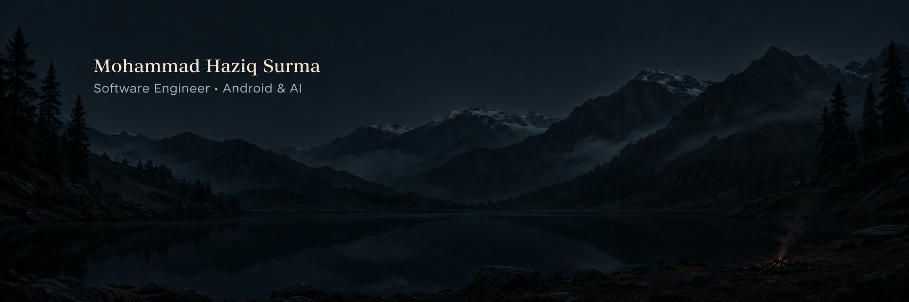

  
  
  

  <picture>
    <source media="(max-width: 640px)" srcset="https://raw.githubusercontent.com/Haziq16/Haziq16/main/assets/section-about-narrow.svg">
    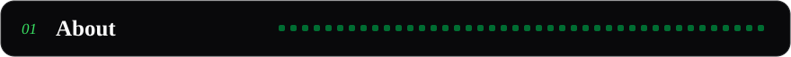
  </picture>

I'm **Mohammad Haziq Surma**, a software developer with a background in Software Engineering at **Universiti Sains Malaysia**. I build Android apps with Kotlin and Jetpack Compose, and explore how AI can make everyday software more useful.

My projects span children's learning, driving assistance, health and fitness, and media tools. I enjoy the work between the screens too: connecting APIs, storing data locally, working with device sensors, and making a complete user journey work.

At **Medna Labs, USM**, I worked on NavigateMe, including GPS tracking, route visualization, sensor-based driving events, and Firebase integration. I also gained experience in requirements tracking, coordination, and progress reporting as a **Junior PMO at K2 Logix**.

I'm interested in **Android and AI development opportunities**, including remote work and relocation. Away from the keyboard, I enjoy rock climbing, reading, poetry, and music.

  <picture>
    <source media="(max-width: 640px)" srcset="https://raw.githubusercontent.com/Haziq16/Haziq16/main/assets/section-build-narrow.svg">
    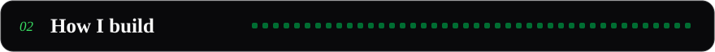
  </picture>

  <picture>
    <source media="(max-width: 640px)" srcset="https://raw.githubusercontent.com/Haziq16/Haziq16/main/assets/method-narrow.svg">
    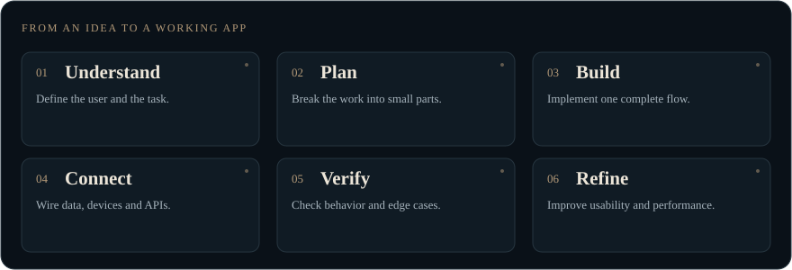
  </picture>

I break projects into manageable pieces and work through complete features: the screen, the data behind it, and the behavior on a device. I use AI coding tools to help implement and explore ideas, then check the result against what the user needs.

  <picture>
    <source media="(max-width: 640px)" srcset="https://raw.githubusercontent.com/Haziq16/Haziq16/main/assets/section-featured-narrow.svg">
    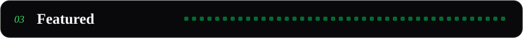
  </picture>

<a href="https://github.com/Haziq16/jobcompass">
  <picture>
    <source media="(max-width: 640px)" srcset="https://raw.githubusercontent.com/Haziq16/Haziq16/main/assets/jobcompass-narrow.svg">
    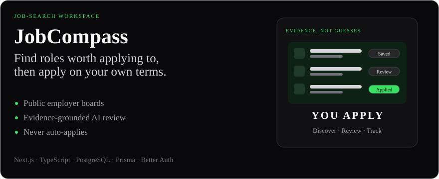
  </picture>
</a>

**JobCompass** is a job-search workspace that discovers roles from public employer boards (Greenhouse, Lever, Ashby, Workable and Recruitee), reviews a CV against a job with evidence-quoted AI feedback and CV tailoring using the user's own AI key, and tracks applications from shortlist to offer. It never submits an application for you: you review and submit every application yourself.

**Built with:** Next.js, TypeScript, PostgreSQL, Prisma, and Better Auth.

[Explore the repository](https://github.com/Haziq16/jobcompass)

<a href="https://github.com/Haziq16/toddler-english-app">
  <picture>
    <source media="(max-width: 640px)" srcset="https://raw.githubusercontent.com/Haziq16/Haziq16/main/assets/toddler-english-narrow.svg">
    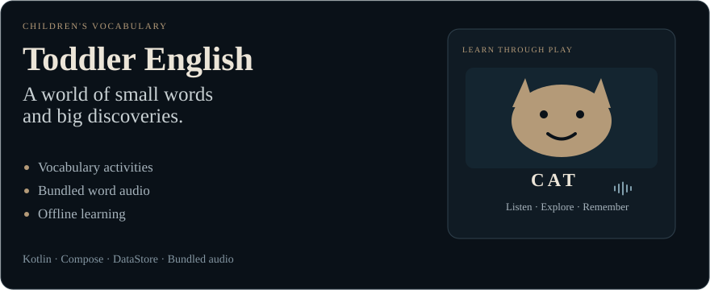
  </picture>
</a>

**Toddler English** is an offline Android vocabulary app for children aged 1–5. It combines illustrated scenes, bundled word audio, gentle mini-games, chants, stickers, and a parent corner. It is separate from the older TinyTalk project.

**Built with:** Kotlin, Jetpack Compose, DataStore, SoundPool, and Media3.

[Explore the repository](https://github.com/Haziq16/toddler-english-app)

  <picture>
    <source media="(max-width: 640px)" srcset="https://raw.githubusercontent.com/Haziq16/Haziq16/main/assets/section-more-narrow.svg">
    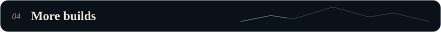
  </picture>

| Project | What I'm building |
| --- | --- |
| **NavigateMe** | An Android driving companion with route visualization, location tracking, accelerometer and gyroscope driving-event detection, local logs, and weather and air-quality information. Built with Kotlin, Jetpack Compose, Google Maps, Room and Firebase. Source isn't public yet. |
| **MyHealth** | A health and fitness app with exercise guides, recipes, BMI and water tracking, OCR, and AI-assisted suggestions. Source isn't public yet. |

  <picture>
    <source media="(max-width: 640px)" srcset="https://raw.githubusercontent.com/Haziq16/Haziq16/main/assets/section-stack-narrow.svg">
    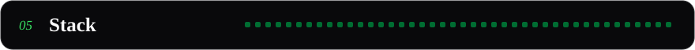
  </picture>

  <picture>
    <source media="(max-width: 640px)" srcset="https://raw.githubusercontent.com/Haziq16/Haziq16/main/assets/project-stack-narrow.svg">
    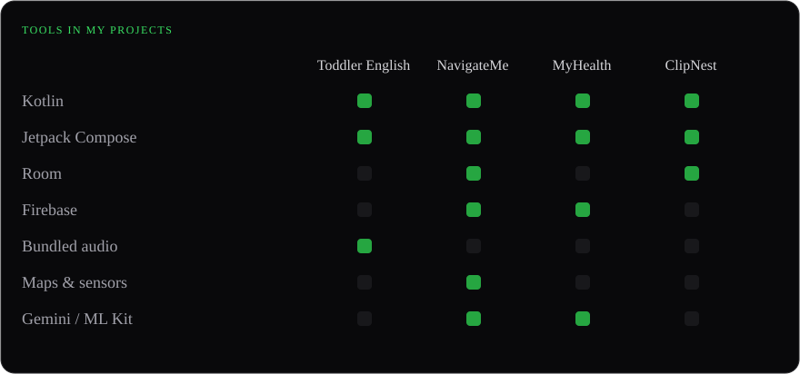
  </picture>

My main tools are **Kotlin, Jetpack Compose, Room, Firebase, and Android Studio**. Depending on the project, I also work with REST APIs, device sensors, speech recognition, CameraX, ML Kit, and Gemini. On the web, JobCompass uses Next.js, TypeScript, PostgreSQL and Prisma.

  <picture>
    <source media="(max-width: 640px)" srcset="https://raw.githubusercontent.com/Haziq16/Haziq16/main/assets/section-github-narrow.svg">
    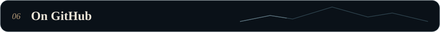
  </picture>

[Browse my public repositories](https://github.com/Haziq16?tab=repositories) · [JobCompass source](https://github.com/Haziq16/jobcompass) · [Toddler English source](https://github.com/Haziq16/toddler-english-app)

  <picture>
    <source media="(max-width: 640px)" srcset="https://raw.githubusercontent.com/Haziq16/Haziq16/main/assets/footer-narrow.svg">
    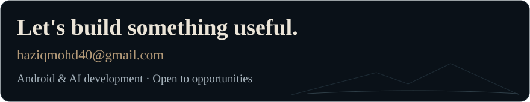
  </picture>

  
  
  

Original alpine banner. Supporting graphics adapted from the earlier design inspired by [Sowan3k's profile](https://github.com/Sowan3k).

